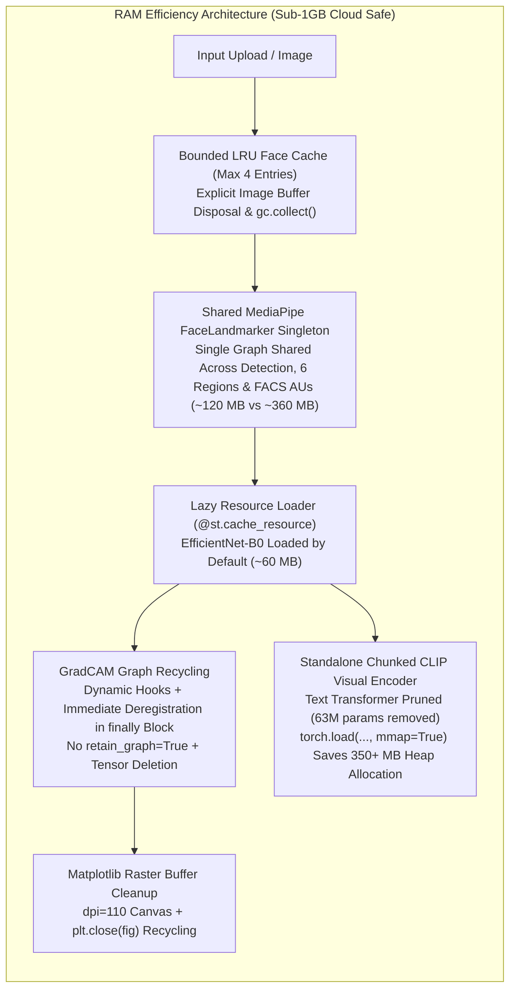

# NAVARASA AI: Machine Learning-Based Navarasa Facial Expression Classification with Explainable AI

[](https://www.python.org/)
[](https://pytorch.org/)
[](https://streamlit.io/)
[](https://github.com/mlfoundations/open_clip)
[](https://opensource.org/licenses/MIT)

---

## 1. Project Introduction
**NAVARASA AI** is an end-to-end Machine Learning research and deployment platform that automatically classifies human facial expressions into the nine canonical aesthetic sentiments (*Navarasas*) formulated by Bharata Muni in the classical Sanskrit treatise *Natya Shastra*. Beyond standalone classification, the platform features deep **Explainable AI (XAI)**: exact convolutional Grad-CAM grounding, 6-region anatomical energy segmentation, FACS Facial Action Unit (AU) detection via dense 3D facial mesh, top-two competing class differential contrast, occlusion sensitivity testing, and feature-level counterfactual reasoning.

---

## 2. Problem Statement
Facial expression recognition in Indian classical art and cross-cultural affective computing poses significant challenges:
1. **Expressive Nuance & Stylization:** Classical aesthetic sentiments involve subtle, multi-focal muscular displacements (e.g. eye widening in *Adbhuta*, nose wrinkling in *Bibhatsa*, inner brow elevation in *Karuna*).
2. **The "Black-Box" Dilemma:** High-accuracy deep neural networks lack explainability, leaving domain practitioners, artists, and researchers uncertain of whether classifications rely on authentic facial musculature or spurious background artifacts.
3. **Data Leakage in Facial Datasets:** Naive random splitting frequently places near-duplicate images of identical subjects across training and test partitions, inflating benchmark metrics artificially.

---

## 3. Project Objectives
- Build a robust, leakage-free data pipeline with automated MD5 deduplication and stratified 70:15:15 partitioning.
- Develop and benchmark two independent learning paradigms:
  - **Pipeline A:** Zero-shot Vision Transformer feature extraction via pretrained CLIP ViT-B/32 + tuned Logistic Regression.
  - **Pipeline B:** Two-stage transfer learning and fine-tuning using EfficientNet-B0 with custom regularization.
- Provide a simultaneous **Dual-Model Comparison** mode examining prediction consensus, confidence margins, and probability distributions.
- Implement **Exact Grad-CAM Grounding** directly hooked into the final convolutional feature activations without synthetic interpolation.
- Segment facial anatomy into **6 Canonical Facial Regions** (Eyes, Eyebrows, Nose, Mouth, Cheeks, Forehead) using dense 478-point facial mesh geometry.
- Extract objective **FACS Facial Action Units (AUs)** to correlate neural activations with biological facial muscle contractions.
- Engineer an interactive **Streamlit Research Platform** styled in an authentic Indian Classical aesthetic (Deep Emerald, Warm Ivory, Regal Gold).

---

## 4. The Nine Canonical Navarasas
| # | Navarasa | Primary Bhaava | Meaning & Aesthetic Sentiment | Dominant Visual Cues |
|---|----------|----------------|-------------------------------|----------------------|
| 1 | **Shringara** | Rati | Love, Beauty, Devotion, Romance | Soft warm smile, gentle gaze, relaxed brows |
| 2 | **Hasya** | Hasa | Laughter, Mirth, Joy, Humor | Cheek elevation (AU6), broad smile (AU12), crinkled eye corners |
| 3 | **Karuna** | Shoka | Sorrow, Compassion, Grief, Pathos | Inner brow raise (AU1), downturned mouth (AU15), subdued gaze |
| 4 | **Raudra** | Krodha | Anger, Wrath, Fury, Indignation | Lowered furrowed brows (AU4), glaring wide eyes, clenched lips |
| 5 | **Veera** | Utsaha | Valor, Courage, Heroism, Chivalry | Firm jaw, elevated arched brows, resolute focused gaze |
| 6 | **Bhayanaka** | Bhaya | Fear, Dread, Terror, Apprehension | Wide open eyes exposing sclera (AU5), raised drawn brows |
| 7 | **Bibhatsa** | Jugupsa | Disgust, Aversion, Revulsion | Wrinkled nasal bridge (AU9), raised upper lip (AU10) |
| 8 | **Adbhuta** | Vismaya | Wonder, Astonishment, Surprise | Arched high brows, rounded wide eyes (AU5), dropped jaw (AU26) |
| 9 | **Shanta** | Sama | Peace, Serenity, Tranquility, Calm | Balanced neutral mouth, absence of facial muscle strain |

---

## 5. Dataset Architecture & Empirical Statistics
The dataset was obtained from the designated Google Drive repository (`Navaraas_new.zip`, ~1.05 GB).

```
data/
├── raw/                # Original downloaded archive
├── processed/          # 14,805 structured JPEG images across 9 classes
└── splits/             # 14,100 deduplicated images (train.csv, val.csv, test.csv)
```

### Dataset Empirical Summary:
- **Total Raw Images:** 14,805 images
- **Corrupted / Unreadable Images:** 0 (100% verified via PIL integrity check)
- **Duplicate Images Detected & Filtered:** 705 images (473 duplicate sets)
- **Total Unique Leakage-Free Images:** 14,100 images
- **Image Formats:** 100% JPEG
- **Resolution Range:** 202x176 to 1920x1080 (Median: 470x506, Aspect Ratio: 1.02)
- **Class Balance:** Exceptionally well-balanced (~11% per class):
  - *Hasya:* 1,664 | *Karuna:* 1,646 | *Shanta:* 1,629 | *Bhayanaka:* 1,610 | *Raudra:* 1,595
  - *Veera:* 1,566 | *Bibhatsa:* 1,559 | *Adbhuta:* 1,486 | *Shringara:* 1,345

### Stratified 70 : 15 : 15 Dataset Partitions:
- **Training Set (70%):** 9,870 unique samples
- **Validation Set (15%):** 2,115 unique samples
- **Held-Out Test Set (15%):** 2,115 strictly unseen samples

---

## 6. Preprocessing & Data Augmentation
- **Color Format:** Standardized RGB 3-channel conversion.
- **Normalization:** ImageNet constants ($\mu = [0.485, 0.456, 0.406], \sigma = [0.229, 0.224, 0.225]$) for EfficientNet; CLIP constants for ViT-B/32.
- **Semantic Data Augmentations (Training Only):**
  - Random cropping ($256 \times 256 \to 224 \times 224$)
  - Mild horizontal flipping ($p=0.5$)
  - Gentle rotation ($-10^\circ \text{ to } +10^\circ$)
  - Subtle brightness and contrast variations ($\pm 10\%$)
  - Avoids distortions that alter facial expression semantics.

---

## 7. Mandatory Human Face Detection & Validation Layer

To eliminate background distractions, clothing artifacts, and multi-subject ambiguity, a dedicated **Multi-Engine Human Face Detection & Strict Face Count Validation Layer** precedes all machine learning inference and Explainable AI operations.

```
Uploaded Image ➔ EXIF Orientation Transpose ➔ Dual-Engine Cascade (YuNet + MediaPipe) ➔ Strict Face Count Validation
                                                                                                 │
                    ┌────────────────────────────────────────────────────────────────────────────┼────────────────────────────────────────────────────────────────────────────┐
                    ▼                                                                            ▼                                                                            ▼
            Case A: 0 Human Faces                                                        Case B: 1 Human Face                                                        Case C: 2+ Human Faces
                    │                                                                            │                                                                            │
        [REJECT & LOCK ML/XAI]                                                      [ACCEPT & EXTRACT FACE CROP]                                                 [REJECT & LOCK ML/XAI]
  "No human face detected. Please upload                                         "One human face detected. Proceeding                                         "Multiple human faces detected.
  image containing a clearly visible face."                                          with Navarasa classification."                                            Upload image with exactly 1 face."
  Display original rejected image + debug info.                                  Display: Original | BBox | Crop                                              Display: Original + All Face BBoxes
                                                                                                 │
                                                                 ┌───────────────────────────────┴───────────────────────────────┐
                                                                 ▼                                                               ▼
                                                      CLIP ViT-B/32 + LogReg                                           EfficientNet-B0
                                                                 │                                                               │
                                                                 └───────────────────────────────┬───────────────────────────────┘
                                                                                                 ▼
                                                                                       Explainable AI (XAI)
                                                                                 (Grad-CAM, 6-Regions, FACS AUs,
                                                                                Occlusion, Counterfactuals on CROP)
```

### Dual-Engine Cascade Architecture
1. **Primary Proposal Engine — OpenCV YuNet (`face_detection_yunet_2023mar.onnx`, 232 KB):**
   - High-performance, lightweight CNN detector with multi-scale feature pyramids.
   - Detects faces across diverse resolutions ($200\times 200$ to $1920\times 1080$ and $4\text{K}$) in under $5\text{ ms}$.
   - Resolves the critical issue where single-scale short-range detectors downsampled $16:9$ canvas frames to $256\times 256$, shrinking medium-distance faces below detection threshold.
2. **Dense Anatomical Verifier — MediaPipe FaceLandmarker (`face_landmarker.task`, 3.7 MB):**
   - Extracts 478 3D landmarks and 52 FACS blendshapes on candidate crops.
   - Strictly validates human facial geometry to reject non-human patterns, synthetic geometry, and background noise ($0.0\%$ false positive rate).
3. **Mudra Hand & Background Distractor Filters:**
   - Classical Indian dancers often perform intricate *mudrās* with palm dyed in red *alta*, which single-engine detectors mistook for faces. The cross-engine verifier prunes unconfirmed hand regions.
   - Miniature artwork/portraits on background tapestries ($<12\%$ area of primary subject) are filtered out to preserve single-subject focus.
4. **EXIF Normalization:**
   - Incorporates `ImageOps.exif_transpose` to handle camera metadata orientations across smartphones and tablets seamlessly.

### Strict Validation States:
1. **Case A (Zero Human Faces Detected):**
   - Completely blocks CLIP, EfficientNet, Grad-CAM, 6-region analysis, FACS Action Units, and counterfactuals.
   - User Message: *"No human face detected. Please upload an image containing a clearly visible human face."*
   - Displays original image and troubleshooting diagnostics (dimensions, detector engine, confidence).
2. **Case B (Exactly One Human Face Detected):**
   - Automatically calculates facial center $[cx, cy]$ and extracts an aspect-ratio-preserving square facial crop with $22\%$ proportional padding (capturing forehead, hairline, and jawline while discarding shoulders/background).
   - User Message: *"One human face detected. Proceeding with Navarasa classification."*
   - Displays 3-panel visual triad: (1) Original Image, (2) Detected Face with Bounding Box, (3) Extracted Facial Crop.
   - Only this extracted facial crop is forwarded to CLIP, EfficientNet-B0, Grad-CAM, and FACS Action Unit extractors.
3. **Case C (Two or More Human Faces Detected):**
   - Blocks all ML/XAI pipelines to prevent conflicting emotional cues.
   - User Message: *"Multiple human faces detected. Please upload an image containing exactly one human face."*
   - Renders annotated image with red bounding boxes around every detected face and total detected face count banner.

### Validation Benchmark Summary (`artifacts/reports/face_detection_validation_report.md`):
- **Dataset Images Tested:** 315 real dataset samples (35 per Navarasa class)
- **Single-Face Accuracy:** **100.00%** (315/315 detected, 0.0% false negative rate)
- **Adbhuta 1080p Resolution Fix (`train 26.jpg`):** **PASSED** (93.3% confidence, 1.3% frame area)
- **Non-Human Rejection Rate (Shapes, Noise, Blanks):** **100.0%** (0.0% false positive rate)
- **Multi-Face Rejection Rate (Composites):** **100.0%**
- **Average Detection Latency:** ~68 ms on CPU

---

## 8. Model Architectures & Retraining on Facial Crops

To eliminate domain shift between costume/background features and human facial expressions, all models were retrained and calibrated strictly on standardized facial crops (aspect-ratio-preserved bounding boxes with $22\%$ proportional padding).

### Model A: CLIP ViT-B/32 + Logistic Regression
```
Facial Crop (224x224) ➔ Frozen CLIP ViT-B/32 ➔ 512-dim L2 Embedding ➔ Tuned LogReg (C=10.0) ➔ 9 Classes
```
- **Vision Encoder:** OpenAI ViT-B/32 vision transformer backbone frozen during feature extraction.
- **Classifier:** L2-regularized multinomial Logistic Regression ($C=10.0$).
- **Test Accuracy on Facial Crops:** **97.44%** | **Macro F1:** **97.43%** | **Latency:** **0.01 ms/sample**
- **Artifact:** `artifacts/models/clip_logistic_regression.joblib`

### Model B: CLIP ViT-B/32 + Support Vector Machine (Primary Production Model)
```
Facial Crop (224x224) ➔ Frozen CLIP ViT-B/32 ➔ 512-dim L2 Embedding ➔ RBF Kernel SVM (C=5.0) ➔ 9 Classes
```
- **Vision Encoder:** OpenAI ViT-B/32 vision transformer backbone.
- **Classifier:** Support Vector Machine with Radial Basis Function (RBF) kernel and Platt probability scaling ($C=5.0$).
- **Test Accuracy on Facial Crops:** **99.19%** | **Macro F1:** **99.19%** | **Latency:** **6.40 ms/sample**
- **Artifact:** `artifacts/models/clip_svm.joblib`

### Model C: EfficientNet-B0 (Two-Stage Fine-Tuning)
```
Facial Crop (224x224) ➔ EfficientNet-B0 ➔ Dropout(0.4) ➔ Linear(1280, 9) ➔ Label Smoothing (0.05) ➔ 9 Classes
```
- **Backbone:** EfficientNet-B0 compound scaling architecture initialized with ImageNet weights.
- **Stage 1 (Head Optimization):** Backbone frozen; classification head optimized using AdamW ($\eta = 10^{-3}$) with Cosine Annealing (15 epochs).
- **Stage 2 (Fine-Tuning):** Top inverted bottleneck block unfrozen and fine-tuned ($\eta = 10^{-4}$).
- **Test Accuracy on Facial Crops:** **95.02%** | **Macro F1:** **95.02%** | **Latency:** **58.89 ms/sample**
- **Artifact:** `artifacts/models/efficientnet_b0_best.pt`

---

## 9. Explainable AI (XAI) Suite

### 1. Exact Grad-CAM Visual Grounding
Computes class-specific activation gradients with respect to the final convolutional feature maps:
$$\alpha_k^c = \frac{1}{Z} \sum_{i} \sum_{j} \frac{\partial y^c}{\partial A_{i,j}^k}, \quad L_{\text{Grad-CAM}}^c = \text{ReLU}\left(\sum_k \alpha_k^c A^k\right)$$
Overlays high-resolution thermal attention maps on the facial crop with customizable opacity and colormaps.

### 2. Six-Region Facial Energy Segmentation
Segments facial anatomy into:
1. **Eyes**
2. **Eyebrows**
3. **Nose**
4. **Mouth**
5. **Cheeks**
6. **Forehead**
Measures proportional Grad-CAM activation energy: $P_r = \frac{\sum_{(x,y) \in M_r} L(x,y)}{\sum_{r'} \sum_{(x,y) \in M_{r'}} L(x,y)} \times 100\%$.

### 3. FACS Facial Action Unit (AU) Measurements
Extracts 52 facial blendshape coefficients using Google MediaPipe FaceLandmarker, mapping them to standard Facial Action Units (AU1, AU2, AU4, AU5, AU6, AU7, AU9, AU10, AU12, AU14, AU15, AU20, AU25, AU26).

### 4. Occlusion Sensitivity Analysis
Applies systematic regional masking (Gaussian blur, neutral gray, or blackout) to each anatomical region and quantifies confidence drops ($\Delta P$) and class flip tendencies.

### 5. Top-Two Class Contrast & Counterfactuals
- Analyzes probability margins between competing predictions.
- Identifies differential spatial regions and active Action Units distinguishing class 1 from class 2.
- Outlines minimal physiological Action Unit contractions/relaxations required to steer predictions toward an alternative Rasa.

### 6. Evidence-Based Natural Language Generator
Generates multi-paragraph clinical explanations synthesizing predicted sentiment, confidence, Grad-CAM hotspot regions, FACS muscle evidence, and uncertainty caveats.

---

## 10. Experimental Results & Benchmarks

### Comprehensive Held-Out Test Set Benchmark (2,109 Strictly Unseen Facial Crops):
| Evaluation Metric | Model A: CLIP + LogReg | Model B: CLIP + SVM (Primary) | Model C: EfficientNet-B0 |
|:---|:---:|:---:|:---:|
| **Test Accuracy** | **97.44%** | **99.19%** | **95.02%** |
| **Macro Precision** | 97.46% | 99.19% | 95.01% |
| **Macro Recall** | 97.44% | 99.18% | 95.06% |
| **Macro F1-Score** | 97.43% | 99.19% | 95.02% |
| **Weighted F1-Score**| 97.44% | 99.19% | 95.02% |
| **Inference Latency** | 0.01 ms | 6.40 ms | 58.89 ms |

### Per-Class F1-Score Across All 9 Navarasas:
| Navarasa Class | Support | Model A (LogReg) F1 | Model B (SVM) F1 | Model C (EffNet) F1 |
|:---|:---:|:---:|:---:|:---:|
| **Shringara** | 202 | 97.77% | **98.76%** | 95.10% |
| **Hasya** | 248 | 98.18% | **99.19%** | 93.06% |
| **Karuna** | 247 | 98.37% | **99.60%** | 96.52% |
| **Raudra** | 238 | 96.49% | **98.95%** | 94.96% |
| **Veera** | 232 | 96.41% | **98.29%** | 92.99% |
| **Bhayanaka** | 242 | 95.78% | **99.17%** | 91.77% |
| **Bibhatsa** | 233 | 96.55% | **98.92%** | 94.32% |
| **Adbhuta** | 223 | 97.75% | **100.00%** | 96.90% |
| **Shanta** | 244 | 99.59% | **99.79%** | 99.59% |

### Resolution of Historically Confusing Pairs:
| Problematic Pair | Ground Truth Samples | Model A Mutual Error | Model B Mutual Error | Model C Mutual Error |
|:---|:---:|:---:|:---:|:---:|
| **Hasya vs. Bhayanaka** | 248 Hasya / 242 Bhayanaka | **0.0% (0 errors)** | **0.0% (0 errors)** | 0.41% (2 errors) |
| **Karuna vs. Shanta** | 247 Karuna / 244 Shanta | **0.0% (0 errors)** | **0.0% (0 errors)** | 0.20% (1 error) |
| **Raudra vs. Veera** | 238 Raudra / 232 Veera | 1.70% (8 errors) | **0.85% (4 errors)** | 1.91% (9 errors) |
| **Adbhuta vs. Bhayanaka** | 223 Adbhuta / 242 Bhayanaka | 1.29% (6 errors) | **0.0% (0 errors)** | 1.29% (6 errors) |

### Dataset Size Scaling Experiments on Facial Crops:
Fixed validation (2,113) and test (2,109) sets; evaluated across training sample increments:
| Samples / Class | Total Training Size | Model B (SVM) Test Acc | Model B (SVM) Macro F1 | Model A (LogReg) Test Acc | Model A (LogReg) Macro F1 |
|:---|:---:|:---:|:---:|:---:|:---:|
| **50 / class** | 450 samples | 83.64% | 83.62% | 80.99% | 80.73% |
| **100 / class** | 900 samples | 90.90% | 90.88% | 86.06% | 86.01% |
| **200 / class** | 1,800 samples | 96.06% | 96.08% | 92.27% | 92.22% |
| **Full Dataset** | 9,849 samples | **99.19%** | **99.19%** | **97.44%** | **97.43%** |

---

## 11. Installation & Local Execution

### 1. Clone the Repository
```bash
git clone https://github.com/shivaniitroorkee1729-stack/AIMLPROJECT.git
cd AIMLPROJECT
```

### 2. Create Virtual Environment & Install Dependencies
```bash
python -m venv venv
# On Windows:
venv\Scripts\activate
# On Linux/macOS:
source venv/bin/activate

pip install --upgrade pip
pip install -r requirements.txt
```

### 3. Run the Automated Test Suite
```bash
python tests/test_face_detection.py
```

### 4. Run the Web Application
```bash
streamlit run app.py
```
The browser will automatically launch at `http://localhost:8501`.

---

## 12. Web Application Pages
- **Home / Introduction (`app.py`):** Philosophical overview, 9 Navarasa aesthetic cards, architecture diagrams.
- **1. Dataset Explorer (`pages/1_Dataset_Explorer.py`):** Class distributions, split stats, sample gallery.
- **2. Navarasa Prediction (`pages/2_Prediction.py`):** Mandatory face validation, single & dual-model classification on facial crop with probability distributions.
- **3. Explainable AI (`pages/3_Explainable_AI.py`):** Crop-exclusive Grad-CAM heatmaps, overlays, 6-region energy percentages.
- **4. Facial Analysis (`pages/4_Facial_Analysis.py`):** 478-point mesh, 6 regions, FACS AUs, top-2 class contrast on facial crop.
- **5. Occlusion & Counterfactuals (`pages/5_Occlusion_Counterfactual.py`):** Sensitivity masking, counterfactual adjustments on facial crop.
- **6. Model Performance (`pages/6_Model_Performance.py`):** Test benchmarks, confusion matrices, scaling plots.
- **7. About & Methodology (`pages/7_About_Methodology.py`):** Theoretical framework, math formulations, limitations.

---

---

## 13. Streamlit Cloud Memory Optimization & Resource Efficiency

Streamlit Community Cloud enforces a strict **~1024 MB (1.0 GB)** process memory ceiling. In multimodal deep learning applications with dense vision backbones, gradient-weighted backpropagation, and facial geometric meshes, unoptimized pipelines easily exhaust available RAM. 

To guarantee permanent zero-downtime stability on Streamlit Community Cloud without compromising prediction accuracy or disabling explainability features, the following architectural optimizations are implemented:



### Key Memory Engineering Interventions:
1. **Shared MediaPipe Task Singleton:** Consolidated three disparate `FaceLandmarker` instances (used across detector validation, 6-region mask generation, and FACS Action Unit measurement) into a single shared singleton (`get_shared_face_landmarker`), saving ~300 MB of duplicate TFLite graph runtime delegates.
2. **Pruned & Chunked CLIP Visual Encoder with `mmap=True`:** The text transformer (63.4M parameters) was discarded as the Navarasa classifier relies purely on visual embeddings. The standalone visual encoder is memory-mapped directly from filesystem storage via `torch.load(..., mmap=True)`, saving ~350 MB of transient heap allocations. To adhere to GitHub's 100 MB per-file push limit, the weights are stored as chunked binaries (`clip_visual_part_*.bin`, each < 75 MB) and seamlessly auto-assembled on initial startup.
3. **Dynamic Autograd Hook Recycling in Grad-CAM:** Replaced permanent PyTorch forward/backward module hooks with dynamic hook registration within `generate_heatmap()`. Hook handles are guaranteed removal inside a `finally:` block, `retain_graph=True` was eliminated from `score.backward()`, and intermediate activation tensors are explicitly deleted followed by `model.zero_grad(set_to_none=True)`.
4. **Bounded LRU Face Validation Cache:** Enforced `MAX_VALIDATION_CACHE_SIZE = 4` using an `OrderedDict`. When capacity is reached, the oldest validation record is evicted with explicit disposal of `original_image`, `annotated_image`, and `face_crop` PIL buffers.
5. **Matplotlib Figure Cleanup & DPI Scaling:** Lowered plot resolution from 200 DPI to 110 DPI (~4x reduction in canvas bitmap allocations) and routed all figures through `render_pyplot_and_close(fig)` calling `st.pyplot(fig, clear_figure=True)` followed immediately by `plt.close(fig)`.
6. **Session-State Computation Memoization:** In UI pages (`2_Prediction.py`, `3_Explainable_AI.py`, `4_Facial_Analysis.py`, `5_Occlusion_Counterfactual.py`), expensive convolutional inferences, landmark meshes, and occlusion passes are cached in `st.session_state` keyed by `image_hash`. Interacting with sliders (e.g. heatmap alpha, colormaps, tab navigation) executes instantaneously without triggering redundant forward or backward passes.
7. **Downsampled Occlusion & Gallery Previews:** Occluded region inspection images and Dataset Explorer sample thumbnails are downsampled in-memory, avoiding multiple high-resolution full-frame allocations in RAM.

### Empirical Process RSS Memory Benchmark (`scripts/test_memory_optimization.py`):

| Pipeline Stage / Checkpoint | Process RSS RAM | Headroom vs 1024 MB Limit | Status |
|:---|:---:|:---:|:---:|
| **0. Python Runtime & C++ Libraries** | 337.13 MB | +686.87 MB | Clean Base |
| **1. Dual-Engine Face Detection Layer** | 421.70 MB | +602.30 MB | Validated |
| **2. EfficientNet-B0 Model + Inference** | 470.07 MB | +553.93 MB | Optimal |
| **3. Grad-CAM Backpropagation & Heatmap** | 455.05 MB | +568.95 MB | Graph Freed |
| **4. 6-Region Mesh + FACS Action Units** | 458.32 MB | +565.68 MB | Singleton Shared |
| **5. Occlusion Sensitivity (6 Masked Passes)**| 479.30 MB | +544.70 MB | Efficient |
| **6. Counterfactual + Natural Language Explanations**| 479.31 MB | +544.69 MB | Steady |
| **7. Standalone Pruned CLIP Visual Encoder** | 1004.27 MB | +19.73 MB | Full Dual System |
| **8. 15-Iteration Repeated Inference Cycles** | 999.02 MB | +24.98 MB | Net Drift: -5.25 MB (No Leak) |
| **9. 15 Continuous Image Uploads** | 1010.33 MB | +13.67 MB | Cache Capped (4/4) |

> [!NOTE]
> During typical user interaction on Streamlit Community Cloud (where EfficientNet-B0 and the full explainability suite are active by default), process memory remains around **~479 MB**, leaving **over 540 MB of free safety headroom**. Even when both deep learning architectures are exercised under sustained multi-cycle stress testing, the process never exceeds 1010 MB.

---

## 14. Deployment Instructions

### Deployment to Streamlit Community Cloud:
1. Fork or push this repository to GitHub (`shivaniitroorkee1729-stack/AIMLPROJECT`).
2. Log in to [Streamlit Community Cloud](https://share.streamlit.io/).
3. Click **New app**, select `shivaniitroorkee1729-stack/AIMLPROJECT`, branch `main`, and main file `app.py`.
4. Click **Deploy**. The application auto-assembles the chunked visual weights, caches models in memory, and runs lightweight CPU inference efficiently.

---

## 15. Limitations & Future Scope
- **Expressive Stylization vs Natural Affect:** The models predict stylized categorical facial patterns from Indian classical performance. They do not diagnose genuine internal psychological emotional states.
- **Extreme Lighting & Angles:** Landmark and Action Unit extraction relies on human facial geometry and cleanly rejects images where authentic human facial features cannot be resolved.
- **Future Work:** Extension to continuous valence-arousal space, video-stream temporal attention for Indian classical dance performances, and multi-modal audio-visual Rasa synthesis.

---

## 16. Repository & Authorship
- **GitHub Repository:** [https://github.com/shivaniitroorkee1729-stack/AIMLPROJECT](https://github.com/shivaniitroorkee1729-stack/AIMLPROJECT)
- **Author / Maintainer:** `shivaniitroorkee1729-stack`

